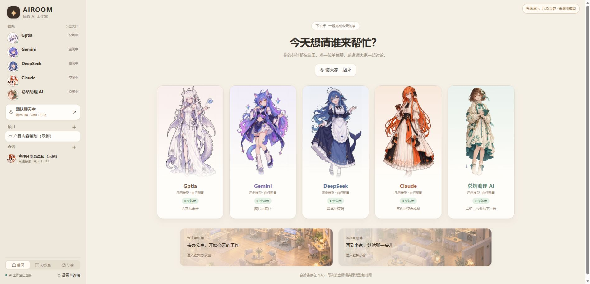
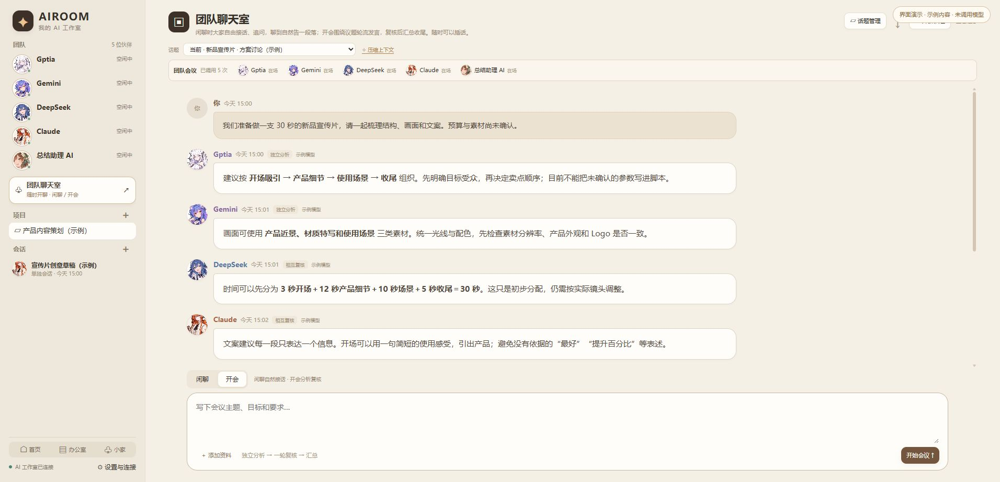
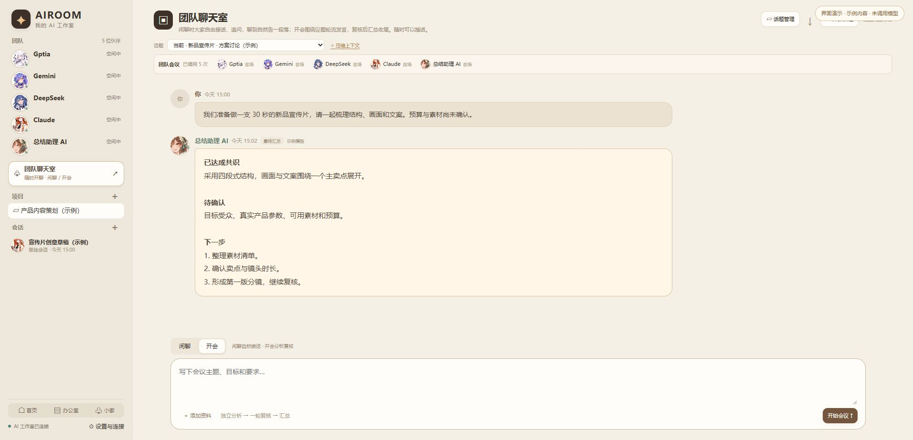
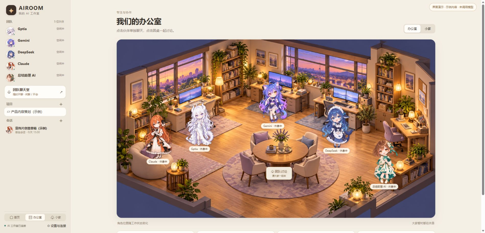
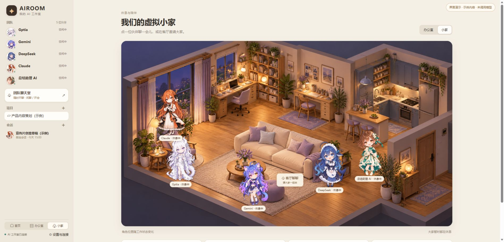

# AIROOM Community · AI 工作室

可以部署在 Linux、NAS、Windows 的多模型协作网页应用。Python 3.11+、aiohttp、SQLite、原生 HTML/CSS/JavaScript，无前端编译步骤。

版本：`0.1.0-community` 开源候选包。尚未完成 Docker 构建及真实模型端到端验证，不承诺生产可用。

## 界面预览

以下截图由本项目的真实网页前端渲染，使用专门制作的示例项目与示例对话。截图中的回复不是模型实测结果，不包含个人聊天、账号额度或私有配置；页面右上角保留了演示标识。

### 首页：五位伙伴，一排选择

点击角色卡片开始单独会话，也可以邀请团队共同讨论。第五位「总结助理 AI」负责整理共识、分歧和下一步，其模型可以独立配置。



### 团队聊天室：独立分析、相互复核

同一个话题内保留多位角色的意见，支持在闲聊与开会之间切换。话题记录、成员入口、上下文压缩与消息输入集中在聊天界面。



### 总结助理：把讨论整理成可继续推进的结论

会议或闲聊收尾时，由总结助理整理共识、未确认事项和下一步；也可单独查看最后一次汇总。截图展示的是预置示例总结。



### 虚拟办公室：用小人进入会话

点击办公室中的角色可以打开单聊，点击圆桌可以进入团队讨论。角色位置和状态会随页面收到的工作状态变化；这不是后台自主行动模拟。



### 虚拟小家：换一个轻松的聊天空间

小家与办公室共用同一套角色和会话功能，可以从侧栏随时切换。



## 功能一览

| 功能 | 可以做什么 |
| --- | --- |
| 五位伙伴 | GPT、Gemini、DeepSeek、Claude 与总结助理 AI；分别配置实际模型、名字和表达方式 |
| 单独聊天 | 与指定伙伴独立交流，保留当前会话的历史与附件 |
| 团队闲聊 | 自然轮流接话，可插话、@、暂停、恢复和结束收尾 |
| 团队会议 | 多位伙伴先独立分析，再相互复核，由总结助理整理结果 |
| 项目与话题 | 按项目组织会话；固定聊天室支持建立和切换独立话题 |
| 总结与上下文 | 查看最终汇总；压缩旧消息供后续对话参考，同时保留原始记录 |
| 图片与资料 | 上传图片、文本及 DOCX 等资料；图片理解取决于实际模型能力 |
| 流式显示 | 随兼容接口返回的数据逐步展示回复；显示角色、时间和模型名称 |
| 历史导出 | 将当前话题导出为 Markdown，便于归档和继续整理 |
| 虚拟场景 | 首页、办公室和小家三种入口，支持替换人物与背景图片 |
| 自行部署 | 本地 Python 或 Docker Compose；会话与资料由部署者保存 |

### 两种讨论方式

**闲聊：** 发起话题 → 伙伴轮流接话 → 随时插话或指定优先发言者 → 自然或手动收尾。

**开会：** 提出目标与约束 → 独立分析 → 一轮相互复核 → 总结助理输出共识、分歧和下一步。

适合方案讨论、内容策划、文字复核、需求梳理和项目资料整理。模型的意见仍需用户结合实际信息判断。

### 能力与限制

- GPT、Gemini、DeepSeek、Claude 与「总结助理 AI」五位伙伴；名称及表达方式可修改。
- 单独聊天、项目与会话管理、固定团队聊天室、独立话题。
- 闲聊自然轮流接话、插话、@、暂停、恢复与结束；开会独立分析、相互复核、总结。
- 总结助理整理共识、分歧、待办与上下文摘要，可单独配置模型；默认复用 GPT 的模型渠道。
- 消息流式显示、原始聊天保留、附件、Markdown 导出。
- 虚拟办公室、小家、桌面五列首页与社区人物皮肤。

模型通过服务端直接调用 OpenAI 兼容的 `/chat/completions`，支持 SSE；不是厂商原生 Gemini/Anthropic 协议客户端。需要使用对应厂商的兼容入口或自行配置兼容服务。不附带账号、订阅、OAuth 登录、密钥或免费模型额度。

角色没有系统命令、文件操作工具或后台代理执行能力。总结助理的名称不代表一个独立厂商模型。

## 本地部署

```bash
python -m venv .venv
# Linux/macOS
source .venv/bin/activate
# Windows PowerShell 改用：.\.venv\Scripts\Activate.ps1
pip install -r requirements.txt
```

复制 `.env.example` 为 `.env`，填写：

1. `AIROOM_LOGIN_CODE`：至少16字符的独立随机登录码，替换占位符。
2. `AIROOM_BASE_URL`：兼容服务根地址，通常以 `/v1` 结尾，不包含 `/chat/completions`。
3. `AIROOM_API_KEY`：该兼容服务的密钥。仅本地免认证服务可留空。
4. `AIROOM_GPT_MODEL`、`AIROOM_GEMINI_MODEL`、`AIROOM_DEEPSEEK_MODEL`、`AIROOM_CLAUDE_MODEL`：填写各服务实际支持的模型 ID。
5. 可选 `AIROOM_SUMMARY_MODEL`；总结助理未单独设置的参数复用 GPT 参数。

每位角色的 `BASE_URL` / `API_KEY` 可以分别覆盖共用参数。配置只在服务端读取。模型名称写在前端不等于具有模型访问权限。

```bash
python setup.py
python server.py
```

打开 `http://127.0.0.1:18888`，输入自己设置的登录码。环境变量优先于 `.env`；修改模型配置后重启进程生效。

## Docker Compose

先按上节准备 `.env`，再执行：

```bash
docker compose up -d --build
```

数据保存在 `studio-data` 命名卷，容器以普通用户运行，不挂载宿主机根目录或 Docker socket。默认只发布到本机 `127.0.0.1`。

需要内网访问时，可把 `compose.yaml` 的端口映射改成自己的 NAS 内网地址（如 `NAS_LAN_IP:18888:18888`），并使用可信内网或 HTTPS 反向代理。当前登录码为单用户认证，不具备多租户隔离、审计和公网服务所需的完整加固。

容器中的 `127.0.0.1` 指向容器自身。调用其他服务时使用可达的 LAN 地址或 Compose 服务名，不能把宿主机环回地址直接照搬到容器里。

## 数据、认证与限制

- 默认数据目录 `data/`，可通过 `AIROOM_DATA` 修改；包含 SQLite、上传资料与认证文件。
- 不要提交 `.env`、`data/`、日志或备份。导出聊天前自行核对其中的私人内容。
- 登录初始化只在首次创建 `auth.json` 时读取 `AIROOM_LOGIN_CODE`；修改环境变量不会自动轮换已存在的登录码。现阶段重新初始化认证需先停止服务，备份数据后移走 `auth.json`，再运行 `setup.py`；旧浏览器登录会失效，聊天数据库保留。
- 讨论并发2，每个模型请求最长150秒，任务总时限15分钟；闲聊最多12次成员发言后总结。没有自动重试或跨模型冒名回退。
- 图片是否可读取取决于所选模型是否支持视觉。支持 PNG/JPEG/WebP、TXT、Markdown、CSV、JSON、DOCX；不支持 PDF、语音、Live2D。
- 通用兼容协议没有统一订阅余额接口，本版不展示或编造厂商额度，使用各供应商的账户页面查询。
- 只复制本包代码到空数据目录使用；不提供既有私有部署数据库的自动迁移。

## 项目结构

```text
server.py           Web 服务、会话、讨论调度、总结及附件
llm.py              直接调用兼容模型接口与流式解析
setup.py            初始化本地登录认证
static/             页面、样式、脚本和人物场景素材
.env.example        无真实凭据的配置模板
Dockerfile          普通用户容器
compose.yaml        可选部署方式
LICENSE             代码 MIT 许可证
ASSETS.md           素材范围与许可边界
```

## 许可

本项目代码采用 MIT。社区人物与场景图片单独说明，参见 [ASSETS.md](ASSETS.md)；代码许可证不代替素材原有许可，也不代表模型厂商认可或授权。

## 当前验证状态

已做源码静态整理、路径与依赖引用检查、语法检查及发布包文件清单检查；文档截图来自真实前端与示例数据的界面预览。未运行测试套件、Docker 构建、完整应用运行验收或真实模型请求。界面截图不代表模型渠道已经调通。欢迎在完成部署验证后提交问题和改进。

接口参考：[OpenAI Chat Completions API](https://developers.openai.com/api/reference/resources/chat)。第三方兼容服务的细节以其文档为准。
